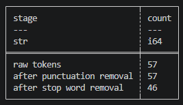
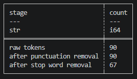
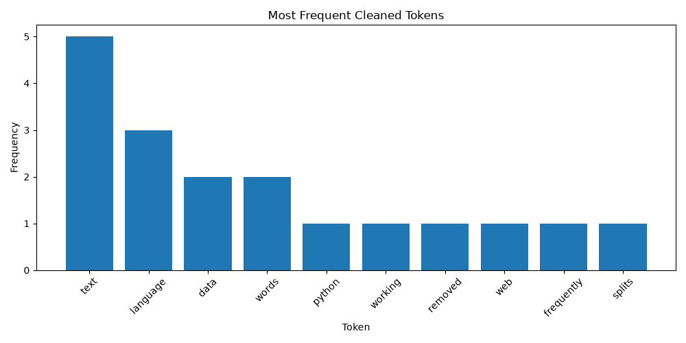
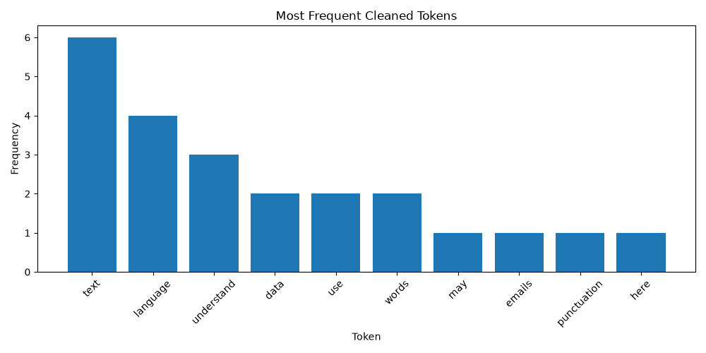
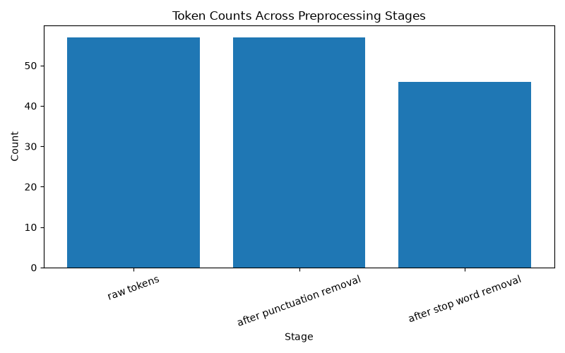
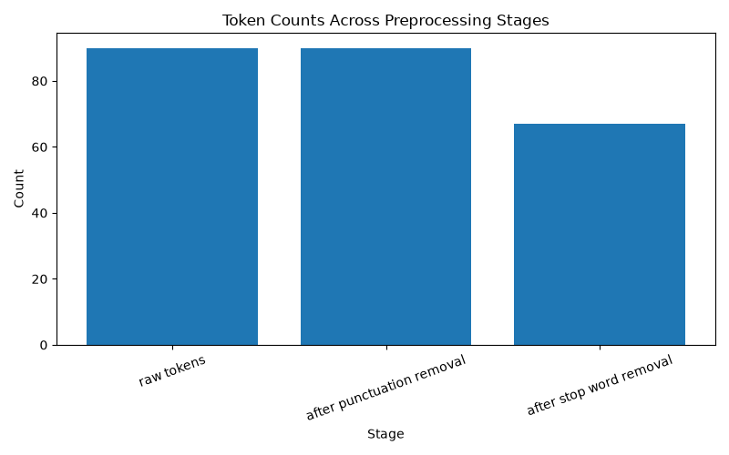
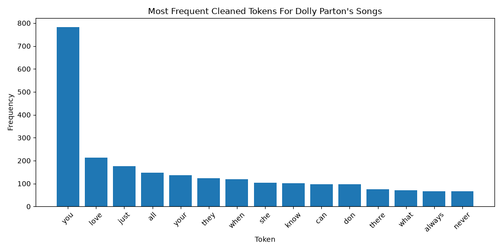
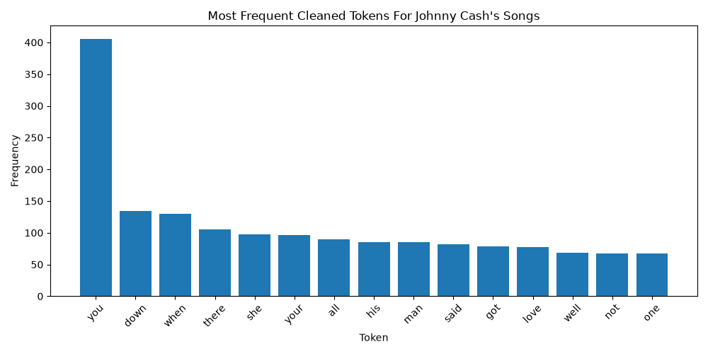
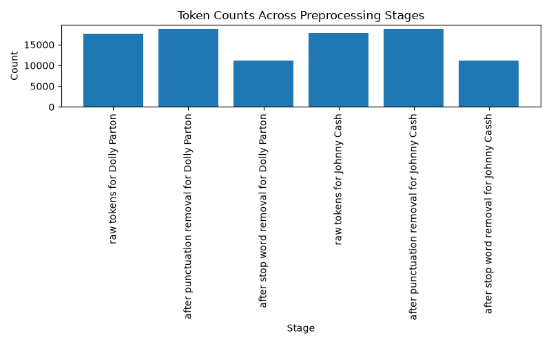

# Phase 4 & 5

- Author: Kim Hummel
- Date: 2026, October

## Phase 4: Technical Modification

In phase 4 of Module 2 we apply a technical modification of the example problem.

For my technical modification I changed a few of the coded outputs and added three more lines of text. They are fairly nonsensical lines but I did make sure to use some of the words that were already in the top 1o bar graph so that the values of the bar graph would change.

For the coding that I changed, in section two I reduced the printed characters from 500 to 50. In section 3 I lowered the number of text records printed from 5 to 2. I lowered the first set of characters printed from 500 to 50. Then after tokenizing the data, section 4, I increased the number of raw tokens printed from 20 to 25. In section five I lowered the number of printed characters of lowercase text from 500 to 50. In section 6 I increased the number of tokens printed from 20 to 25.

I didn't change the graphs in this phase in any way because the values in the tables were changing and I wanted the value changes to be analyzed.

## Results

Since there were more words in the text, there were more words to tokenize and more data points to include in the graph.

Example Data

Phase 4 Data

Because I made sure to include some of the terms already used in the text, it increased some of the most frequently tokenized texts. The word "text" increased from 5 to 6, "language" increased from 3 to 4, and "understand" which wasn't on the chart previous became the third most frequently tokenized word with three instances.

### Frequently Tokenized Words in Bar Graphs

The bar graph for most frequently tokenized words. The example is first, and the phase 4 modification is second.

Example Bar Graph

Phase 4 Bar Graph

Because the number of words increased, in phase 4, the number of instances of cleaning or preparing the data also increased in phase 4 when compared to the original data set

### Token Counts Across Processing Stages in Bar Graphs

The bar graphs show the counts of words/tokens after each stage of processing.

Example Bar Graph

Phase 4 Bar Graph

## Phase 5: Apply to a New Scenario

For phase 5 I decided to pull some lyrics as the new dataset and run the same set of code on it. There were multiple songs by the same artist in the text file. I thought this would give me a larger dataset to work with as well. Out of the folder of different artists I picked Dolly Parton since she was an idol and I am saddened by her recent passing. I thought about doing another artist at the same time, and then having the ability to compare the two artists. I decided to do Johnny Cash as well in order to stay in the same genre of music.

I followed the same steps, but did it for both artists. First I loaded the text and then tokenized the text document of their lyrics of multiple songs. Then I normalized the text by making all of the text lowercase and removing punctuation. After that I removed stop words. Lastly I created frequency tables for both artists and a summary table.

Dolly Parton's Frequency Graph

Johnny Cash's Frequency Graph

Summary Table

## Reflection

This project gave me a lot of experience with how to prepare text for processing.

One thing I wish I had done differently was to add more words to the stop words list. I made the bar graphs display the top 15 tokens and they included the words "when", "there", "just", "what", and "got" which I feel could have been removed to get more words with more specific meaning. I ran out of time and was not able to do this but would be interested to see the results with the removal of those words.
